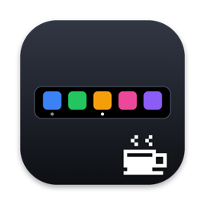

<p align="center">
  
</p>

<h1 align="center">DockTouchBar</h1>

<p align="center">
  <strong>Your Dock on the Touch Bar.</strong>
  <br>
  <strong>Simple · Elegant · Efficient</strong>
  <br>
  Tap to switch · double-tap to minimize · long-press to quit
  <br>
  <a href="https://hooosberg.com/apps/docktouchbar">Product page</a> ·
  <a href="https://hooosberg.com/apps/docktouchbar/diary">Build diary</a>
</p>

<p align="center">
  <a href="https://github.com/hooosberg/DockTouchBar/releases/latest"><strong>⬇ Download DockTouchBar</strong></a>
  <br>
  <sub>One app, one download. Free for personal use.</sub>
</p>

<p align="center">
  <a href="README.md">English</a> ·
  <a href="translations/README.zh-CN.md">简体中文</a> ·
  <a href="translations/README.zh-Hant.md">繁體中文</a> ·
  <a href="translations/README.ja.md">日本語</a> ·
  <a href="translations/README.ko.md">한국어</a> ·
  <a href="translations/README.fr.md">Français</a> ·
  <a href="translations/README.de.md">Deutsch</a> ·
  <a href="translations/README.es.md">Español</a> ·
  <a href="translations/README.pt.md">Português</a> ·
  <a href="translations/README.ru.md">Русский</a> ·
  <a href="translations/README.it.md">Italiano</a> ·
  <a href="translations/README.tr.md">Türkçe</a>
</p>

<p align="center">
  
  
  
  
  
</p>

## What it is

DockTouchBar puts your Dock on the Touch Bar: tap, double-tap, long-press. If you code with AI agents (Claude Code, Codex, Qoder, WorkBuddy, Antigravity…), it also shows live status on the icon of the app each agent runs in: a pixel-art screen with falling digits while it works, **OK** when it's done. That part can be switched off in Settings.

**Download:** [Releases](https://github.com/hooosberg/DockTouchBar/releases/latest) → `DockTouchBar-<version>.dmg`.

*Used "DockTouchBar Vibe" before?* It has been merged into this app (1.24 and later), so there is now one app, one codebase, one release line. Download DockTouchBar, then quit and delete Vibe. Agents you already paired keep working; settings are not carried over.


*Idle: apps aligned to the bottom with a top-right badge dot (red for the frontmost app); a pixel-art coffee cup with live steam.*


*Long-press to quit: a pixel-art countdown in four seasonal scenes. Release early to cancel.*

## Gestures

| Gesture | What happens |
|---|---|
| **Tap** an icon | Switch to the app, or launch it. If its windows are on another desktop (Space), jump there |
| **Double-tap** | Minimize the current window. Needs Accessibility permission. Tap again to restore |
| **Long-press** | Quit the app (same as ⌘Q), with a progress bar and countdown. Release early to cancel. Finder can't be quit, so its windows are closed instead. If the app is waiting for you (an "unsaved changes" sheet), the Touch Bar switches to it and says so |
| **⌥ + long-press** | **Force quit** a frozen app (not Finder) |
| **Trash** | Tap opens it in Finder; double-tap minimizes; long-press closes |
| **Swipe** | Scroll when the icons don't all fit |
| **Coffee cup** (right end) | Take a break: hide the Dock and hand the Touch Bar back to the system (brightness, volume). It returns on its own after 10–60 s |
| **Center / maximize button** (far right) | Center the frontmost window; tap again to maximize, and again to center. Needs Accessibility permission |

Menu bar menu: Show Dock on Touch Bar, Only show running apps, Center the icons, Show the center / maximize button, Hide icon in Dock, Launch at login, Settings…. **Settings** has icon position (left / center / right), icon spacing, break length, centered-window size, double-tap, long-press time and season, yielding to system Touch Bar controls (screenshot / recording and Fn, with a re-check timer that brings the Dock back if the end of a yield is missed), language (12), the Accessibility status and a "why can't I see the Dock?" diagnosis. Other pages: **Pair agents**, **How to use**, **About** (with thanks to contributors).

**Hide the Dock icon:** Settings → General → *Hide icon in Dock* keeps the app running in the background with only the menu bar icon.

## See your AI agents work


*While an agent works, the icon of the app it runs in becomes a little pixel-art screen with falling digits, then shows **OK** when it's done. Tap the icon to dismiss it. Shown: Claude Code, Codex, Qoder, WorkBuddy, Antigravity.*

No agent-specific plugins: copy one prompt, paste it to your agent, and it connects itself. The animation is drawn from the real icon of whatever app the agent runs in, so it works for tools we have never seen.

**Pair an agent in three steps**

1. Open **Settings → Pair agents** and press **Copy prompt**.
2. Paste it to your agent (any agent that can run commands on your Mac). It checks itself first, then connects the best way it can: through its own hooks, or a rule in its long-term instructions; for apps DockTouchBar can watch by itself it changes nothing. It backs up its config first and tells you every step.
3. DockTouchBar itself decides whether verification passed (the agent can't mark itself verified); only then does the agent appear in the list as **Verified**. **Try it** plays the animation without waiting for a task, and **Copy unpair prompt** hands the agent a prompt that undoes its own changes.


- **The app never edits another tool's configuration.** The agent does, on your Mac, after you paste the prompt. Nothing leaves your Mac for this feature.
- Needs an agent that can run a command on your Mac and runs in a desktop app (a terminal or editor works too). If it can't reach the app, it is told to say so instead of claiming success.
- **Terminal CLI agents (Claude Code, Codex CLI, etc.):** When running AI coding tools in your terminal (macOS Terminal, iTerm2, Ghostty, or VS Code embedded terminal), DockTouchBar automatically resolves the process tree across intermediate root processes (such as `/usr/bin/login`) to identify the outer terminal app. While the agent executes commands or thinks, the terminal icon on the Touch Bar displays falling digits, turning to green **OK** once the turn completes.
- Some agents ask you to trust the new hook once (Codex: ChatGPT Settings → Hooks → Trust all).

| Agent | How it connects |
|---|---|
| Claude Code (Terminal / 终端 CLI), Codex (ChatGPT app / CLI), Qoder, WorkBuddy | its own hooks |
| Antigravity, Qwen Work (千问办公) | a rule in its long-term instructions (`GEMINI.md` for Antigravity); no hooks, so it relies on the agent following the rule |
| Doubao Work (豆包) | DockTouchBar reads its session files, read-only |
| **Anything else** | paste the prompt; it picks hooks or an instruction rule and reports back |

The list is only what has been tried (on the author's Mac), not a limit.

## Why

Pock and friends can put the Dock on the Touch Bar, but they do a lot more, and in daily use the bar tends to disappear or stop responding. DockTouchBar keeps to one job and does it well: native Swift and AppKit, no third-party dependencies, event-driven (0.0% CPU idle, about 30 MB), self-healing after sleep, screen unlock and Control Strip restarts, and private APIs resolved at runtime so a missing one switches a feature off instead of crashing. No analytics or accounts; update checks and downloads are the only network use. 12 interface languages.

If DockTouchBar is useful to you, a ⭐ Star on GitHub is the best way to say thanks.

## Requirements

| | |
|---|---|
| Hardware | A Mac with a Touch Bar (MacBook Pro 2016–2022) |
| Tested on | MacBook Pro 13" (M1), macOS 27.0, Touch Bar set to "Expanded Control Strip" |
| Apple silicon | ✅ Developed and used on M1 |
| Intel | ⚠️ Untested. The download is universal but has never run on a real Intel Touch Bar Mac. Reports welcome |
| macOS | Built for 13+, only tested on 27.0 |

- It uses **private Apple APIs** to keep a Touch Bar on screen from a background app, so it cannot be on the Mac App Store and a future macOS update could break it. `swift tools/probe-private-api.swift` shows which ones your macOS still has.
- The Dock takes the **whole** Touch Bar, so the system Control Strip is hidden while it is on. Use the coffee cup to hand it back for a moment.

## Install

1. Download `DockTouchBar-<version>.dmg` from [Releases](https://github.com/hooosberg/DockTouchBar/releases/latest).
2. Drag **DockTouchBar** onto **Applications** and launch it.

The DMG is signed with a Developer ID certificate and notarized by Apple. To compile it yourself, see [Build from source](#build-from-source).

**Accessibility permission (optional).** It enables cross-desktop switching, double-tap minimize, center / maximize, closing Finder's windows, detecting confirmation dialogs and Fn yielding. Turn it on in Settings → Permissions → *Turn on…*, then System Settings → Privacy & Security → Accessibility. If it still asks afterwards, remove the old entry with **−** and add it again, or run `tccutil reset Accessibility com.maohuhu.docktouchbar`.

**Can't see the Dock?** Most often System Settings → Keyboard → "Touch Bar Shows" is "F1, F2, etc. keys". Since 1.16 the app offers to switch it to "Expanded Control Strip". You can also use "Diagnose: why can't I see the Dock?" in the menu.

**A tap doesn't switch desktops?** Run `tools/diagnose-switch.sh com.google.Chrome` from a clone of the repo right after it happens. It is read-only.

## Build from source

Requires the Xcode command line tools.

```bash
git clone https://github.com/hooosberg/DockTouchBar.git
cd DockTouchBar
scripts/install.sh      # build → copy to /Applications → launch
scripts/make-dmg.sh     # build/DockTouchBar-<version>.dmg
```

Without a signing certificate the build is ad-hoc signed, so macOS treats every rebuild as a new app and you must re-grant Accessibility. Set `SIGN_IDENTITY="Apple Development: …"` to keep one identity.

```
Sources/DockTouchBar/   App source
Resources/              Info.plist, app icon
scripts/                build.sh, install.sh, make-dmg.sh, make-icon.swift
tools/                  Diagnostics, agent-pairing checks, README render scripts
assets/                 README images
```

Contributions go through pull requests to `main`.

## Thanks

DockTouchBar is better because of these people:

| Who | Contribution |
|---|---|
| [@thierry-laval](https://github.com/thierry-laval) | Hide the Dock icon (PR #5) · Hold ⌥ while long-pressing to force quit (PR #6) · Universal build fallback (PR #7) |
| [@1dea193073](https://github.com/1dea193073) | Better agent-pairing diagnostics, demo vs. real activity (PR #3) |
| [@Aserti2](https://github.com/Aserti2) | Asked for a way to hide the Dock icon (#4) |
| [@fatHROSE](https://github.com/fatHROSE) | Reported the fn-key yielding, which led to making it optional; suggested right-aligned icons and auto-return, both added in 1.25 (#2) |
| [@hlenyafinland](https://github.com/hlenyafinland) | Early feedback and suggestions (#1) |

The same list is in the app: **Settings → About → Thanks**.

## License

[PolyForm Noncommercial License 1.0.0](LICENSE): free to use, copy, modify and share for **personal and other noncommercial purposes**. Commercial use needs a separate license from the author ([hooosberg.com](https://hooosberg.com/)). This is a source-available license, not an OSI-approved open source license. Copyright © 2026 hooosberg.
